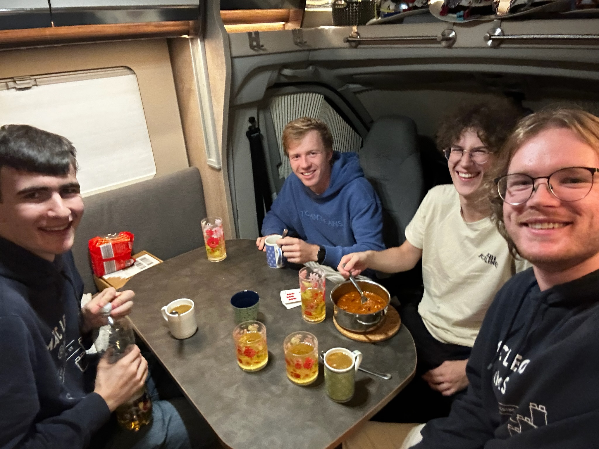

# Team photos

Team MäcLEGO: Clemens, Jannik and Finn.

| Member | Responsibility |
|---|---|
| Clemens | mechanical design: chassis, steering, drive train, tyres, body |
| Jannik | electronics and main PCB, parts of the software |
| Finn | software: estimation, perception, planning and control |

